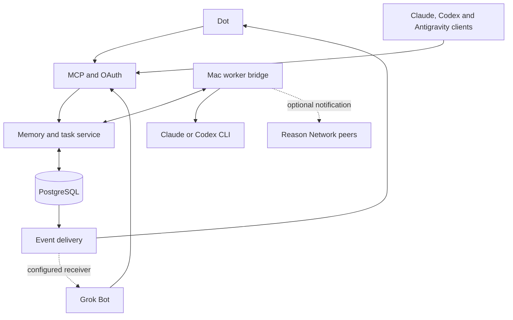

# Swarmaa

Shared memory, task routing and MCP access for Claude Code, Codex, Antigravity, Dot and Grok. Start with `npm run setup` and [docs/SWARMA.md](docs/SWARMA.md); the sections below describe the underlying companion service.

Shared project memory and durable tasks for **Dot and Grok Bot as equal entrypoints**, with Claude, Codex and Antigravity connected to the same records.

This is a source implementation of a small, self-hosted network. PostgreSQL owns the memory, tasks, leases, event outbox and text artifacts. MCP and REST expose the same authorization checks. A bridge on your Mac runs a configured Claude or Codex CLI against a fixed project directory. Reason Network remains an optional peer messaging layer.

**Release state:** source authored and reviewed; dependencies, build, tests, migrations, servers and real provider connections were not executed in the authoring session. Read [docs/STATUS.md](docs/STATUS.md) before setup. This is a starting implementation to validate locally, not a certified deployment.

## Open in Claude

Unzip the archive, open a terminal in this directory, start Claude Code, and ask it to read [CLAUDE_HANDOFF.md](CLAUDE_HANDOFF.md). The repository includes [CLAUDE.md](CLAUDE.md), which explains the implementation boundaries and source-only authoring state.

A normal Claude chat can review uploaded files, but uploading this ZIP does not install a service, import credentials, or connect accounts. Use Claude Code with access to the extracted folder for installation and local verification. If a chat cannot accept ZIP files, attach the handoff and the individual files it needs.

## Architecture



One project scope, such as `project:demo`, identifies a shared workspace in the service. Every connection has a separate identity and an explicit list of scopes. A worker's local config maps each scope to an absolute directory on that machine. Task text cannot choose a command or directory.

The service shares explicit facts, decisions, task state and artifacts. It does not read or merge the private internal memory stores of Claude, ChatGPT, Grok or Antigravity. Each client retrieves the shared context it needs through tools.

## What is included

| Component | Implementation |
|---|---|
| Collective memory | Sourced records, revisions, proposed decisions, conflict records, owner promotion, expiration and live-store retraction |
| Durable work | Idempotent submission, continuation with expected versions, leases, heartbeats, checkpoints, bounded attempts and worker-result artifacts |
| Common access | REST tools, HTTP MCP, a local stdio proxy, opaque connection tokens and OAuth public-client PKCE |
| Notifications | Persistent MCP event subscriptions, signed callback verification and delivery, retries, revocation binding and owner-configured generic sinks |
| Mac execution | Fixed project mapping, one local task at a time, bounded subprocess output/time, lease-loss shutdown and restricted provider settings |
| Client setup | Claude, Codex, Antigravity, Dot and Grok instructions; macOS Keychain launcher examples |
| Upstream | Pinned Reason Network source with original license notices, as an optional component |
| Handoff | Local validation guide, operational instructions, authored tests and an earlier architecture report |

## Local setup

Use a disposable demo project first. You need Node.js 24 (24.x only), npm, and PostgreSQL 16+; the supplied Compose file uses PostgreSQL 17. Docker is optional if you already administer PostgreSQL. Claude/Codex CLIs are needed only when you start their worker adapters.

The commands below are for your local machine. They were not run while creating this source bundle. If your current Claude session is under a code-only policy, explicitly authorize local installation/build/test execution before asking it to run them.

```bash
npm install
npm run init:local
docker compose up -d db
npm run migrate
npm run typecheck
npm test
npm run build
```

`npm install` creates the first `package-lock.json`. Review and retain it; the archive does not contain a fabricated lockfile. Later installs should use `npm ci`. `.env` is created once with random credentials and restrictive local permissions. The initializer refuses to overwrite an existing file.

Create separate connections. `init:local` creates the `.local` directory used below:

```bash
npm run admin -- create --name owner --role admin --scopes '*' --out .local/owner.json
npm run admin -- create --name dot --role frontend --scopes project:demo --out .local/dot.json
npm run admin -- create --name grok --role frontend --scopes project:demo --out .local/grok.json
npm run admin -- create --name demo-worker --role worker --scopes project:demo --out .local/demo-worker.json
npm run admin -- create --name macmini --role worker --scopes project:demo --out .local/macmini.json
npm run admin -- create --name claude-interactive --role frontend --scopes project:demo --out .local/claude.json
npm run admin -- create --name codex-interactive --role frontend --scopes project:demo --out .local/codex.json
npm run admin -- create --name antigravity-interactive --role frontend --scopes project:demo --out .local/antigravity.json
```

Keep the owner credential outside all model clients and worker environments. Only the owner can promote/retract shared directives. The token files contain real secrets after you create them; do not upload them into a chat or commit them.

Start the service in one terminal:

```bash
npm run dev
```

In a second terminal, demonstrate cross-entrypoint service access without calling a model:

```bash
node --env-file=.env --import tsx scripts/demo.ts
```

The demo uses the Dot identity to create a memory and task, reads them with the Grok identity, completes the task with the dedicated demo worker, and reads the result with Grok. It creates clearly labeled demonstration data. It does not prove that either vendor's app has connected; that is a separate client acceptance step.

## Connect your agents

Read [docs/AGENT_SETUP.md](docs/AGENT_SETUP.md) for each client and the bridge. Start with the local stdio proxy for desktop clients. Dot and cloud Grok access require the service to be reachable over HTTPS. [docs/OPERATIONS.md](docs/OPERATIONS.md) describes the public origin, proxy, OAuth redirects, event callback allowlist and credential rotation.

Read tasks run as `<provider>.read` or `auto.read`; edit tasks as `<provider>.patch` or `auto.patch`. Edits are an explicit per-install opt-in (setup's "Allow edits", default read-only): the worker gets the `task:patch` grant and `enable_patch`/`allow_patch` together. Edit tasks run in sandboxed git worktrees with commands allowed, commit to the local branch `swarma/<provider>/<id>` and never push. Antigravity does review and in-project edits, not research. The routing policy picks the provider by order and quota. Interactive Antigravity use over MCP is unchanged.

## Example work request

After connecting Dot or Grok, use:

> In `project:demo`, find any existing task for reviewing this project. Read the shared context. If there is no matching task, submit a review for the configured `claude.read` worker. Ask it to identify the three most useful improvements, cite local files and return a report. Use a stable idempotency key. Save the task ID so I can continue it from the other entrypoint. Do not submit a patch task.

Then ask the other entrypoint:

> Read task `<task-id>` in `project:demo`, retrieve its artifacts when complete, and explain the result. Preserve uncertainty and show any unresolved memory conflicts.

Use the capability strings from [docs/AGENT_SETUP.md](docs/AGENT_SETUP.md); they must exactly match your configured adapter IDs.

## Project map

| Path | Purpose |
|---|---|
| `src/core/` | Memory, tasks, artifacts and tool schemas |
| `src/http.ts`, `src/mcp.ts`, `src/oauth.ts` | HTTP/MCP routing and public-client OAuth |
| `src/events.ts`, `src/webhook.ts` | Durable event delivery and callback controls |
| `src/bridge/`, `src/bridge.ts` | Mac worker orchestration |
| `src/stdio-proxy.ts` | Local MCP proxy for desktop clients |
| `db/migrations/` | Four ordered PostgreSQL migrations |
| `scripts/` | Initialization, migration, identity administration and demo |
| `clients/` | Client configurations, instructions and Keychain launchers |
| `tests/` | Authored unit and PostgreSQL integration tests |
| `vendor/reason-network/` | Optional upstream source at the pinned commit |

Further reading: [API](docs/API.md), [transport](docs/TRANSPORT.md), [security boundaries](docs/SECURITY.md), [validation](docs/VALIDATION.md), [status](docs/STATUS.md), [sources](docs/SOURCES.md).

Tests and builds were not run. Local Codex should validate the changes before integration. The same validation guide is supplied for your Claude Code handoff.
