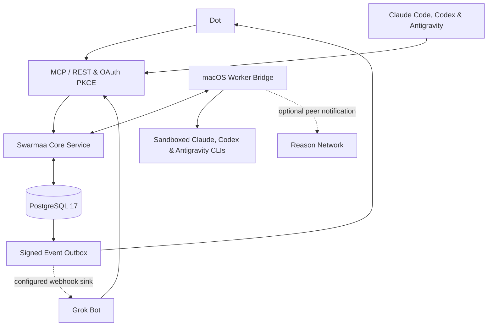

<p align="center">
  
</p>

<h1 align="center">Swarmaa</h1>

<p align="center"><strong>One shared memory and quota-aware task queue for all your coding and chat agents—running locally on your Mac.</strong></p>

<p align="center"><a href="https://github.com/kamatbot/swarmaa/releases/latest/download/Swarmaa.zip"><strong>Download Swarmaa for Mac</strong></a> · macOS 15+ · Apple silicon · open it, choose <em>Set up Swarmaa on this Mac</em>, paste the starter prompt into your agent</p>

<p align="center">
  <a href="LICENSE"></a>
  
  
  <a href="https://swarmaa.com"></a>
</p>

Swarmaa connects **Claude Code**, **Codex**, **Antigravity**, **Dot**, and **Grok Bot** to a single PostgreSQL-backed service over MCP and REST. Any agent can read and propose scoped project memories, hand off durable tasks, and resume work another agent started—while background workers automatically route tasks to whichever provider has the most quota headroom left.

---

## What It Is

- **Shared project memory (`project:<name>`):** Sourced notes, observations, and owner-reviewed decisions/preferences/procedures with optimistic version checks, conflict preservation, and live-store retraction.
- **Quota-aware task routing (`auto.read` / `auto.patch`):** Workers report 5-hour and weekly quota windows (`usage_report`). Swarmaa routes review, research, and patch tasks by your priority policy and remaining quota headroom.
- **Sandboxed background workers:** Local macOS worker bridges run Claude Code, Codex, and Antigravity headlessly with bounded execution time/output, database lease fencing, and Seatbelt credential-directory protection.
- **Isolated git worktree patches:** When edits are opted into, patch tasks run in isolated git worktrees (`~/.swarma/worktrees/`), commit to local `swarmaa/<provider>/<id>` branches, upload a diff artifact, and never push.
- **Cross-harness session journal & distilled lessons:** Hooks and a read-only local poller capture chat turns from Claude Code, Codex, Antigravity, Cursor, OpenCode, GitHub Copilot CLI, Cline, Roo Code, Devin CLI, Hermes, Factory, Pi, Kiro, Windsurf, and Qwen Code—and distill reusable project lessons for owner review.

---

## Quick Start

### Prerequisites

- **macOS** (for Seatbelt worker sandboxing, Keychain launchers, and LaunchAgent autostart)
- **Node.js 24.x** (`.nvmrc` specifies `24`) and `npm`
- **PostgreSQL 17** (`brew install postgresql@17` for automatic local cluster provisioning via `npm run setup`, or Docker / an existing PostgreSQL 16+ instance)

### One-Command Local Setup

```bash
git clone https://github.com/kamatbot/swarmaa.git
cd swarmaa
npm install
npm run setup
```

`npm run setup` launches a local browser onboarding wizard (use `npm run setup -- --cli` for terminal prompts, or `npm run setup -- --dry-run` to preview actions without modifying files). It:

1. Initializes a local PostgreSQL 17 cluster in `.local/pg` on `127.0.0.1:54329` and applies all schema migrations.
2. Generates `.env` with random local credentials and creates one scoped identity per connected client in `.local/<name>.json` (`chmod 600`).
3. Registers the `swarma` MCP server in **Claude Code**, **Codex**, and **Antigravity** using `clients/macos/swarma-mcp.sh` (tokens stay in `.local/*.json` and never appear in client configs or process arguments).
4. Configures read-only background worker bridges (`.local/bridge-<agent>.json`) and optional macOS `LaunchAgents` (`com.swarma.postgres`, `com.swarma.service`, `com.swarma.bridge.<agent>`).

Once connected, type `/swarm` inside Claude Code or Antigravity (or `$swarm` in Codex, after `npx tsx scripts/hooks-install.ts`) to inspect live workers, provider quota headroom, and recent swarm runs.

See [docs/SWARMA.md](docs/SWARMA.md) for day-to-day commands, `/swarm` usage, chat capture, and lesson distillation.

---

## Self-Host & Manual Setup

If you prefer to manage PostgreSQL and identities manually (or run PostgreSQL in Docker):

```bash
npm install
npm run init:local
docker compose up -d db
npm run migrate
npm run typecheck
npm test
npm run build
```

Provision separate scoped identities for each client and worker (keep the `owner` admin credential out of all model clients and worker environments):

```bash
npm run admin -- create --name owner --role admin --scopes '*' --out .local/owner.json
npm run admin -- create --name dot --role frontend --scopes project:demo --out .local/dot.json
npm run admin -- create --name grok --role frontend --scopes project:demo --out .local/grok.json
npm run admin -- create --name claude-interactive --role frontend --scopes project:demo --out .local/claude.json
npm run admin -- create --name codex-interactive --role frontend --scopes project:demo --out .local/codex.json
npm run admin -- create --name antigravity-interactive --role frontend --scopes project:demo --out .local/antigravity.json
npm run admin -- create --name worker-1 --role worker --scopes project:demo --out .local/worker-1.json
```

Start the service and verify the end-to-end flow with the local demo script:

```bash
npm run dev
# In a second terminal:
node --env-file=.env --import tsx scripts/demo.ts
```

### Connecting Hosted Agents (Dot & Grok Bot)

Interactive desktop CLIs talk to `http://127.0.0.1:8787` over the local stdio proxy. Hosted cloud agents (**Dot**, **Grok Bot**, or remote connectors) require an HTTPS endpoint with OAuth PKCE:

- **Tailscale (personal devices):** `tailscale serve --bg 8787`
- **Cloudflare Tunnel (hosted agents):** `npm run tunnel` (or configure `cloudflared` to route your domain to `http://127.0.0.1:8787`), set `PUBLIC_URL=https://<your-host>` and `OAUTH_REDIRECT_HOSTS` in `.env`, and restart the service.

Detailed guides: [Agent & Worker Setup](docs/AGENT_SETUP.md), [Operations & HTTPS/OAuth](docs/OPERATIONS.md), and [Transport & MCP Spec](docs/TRANSPORT.md).

---

## Mac App

The Swarmaa notch app for macOS shows each agent's quota, the swarms running in each project and live task updates, right in your Mac's notch. Its source is at **[kamatbot/NotchTrader](https://github.com/kamatbot/NotchTrader)**, built on **[Codenotch](https://github.com/vinzdg/codenotch)** by Vinz, the open-source macOS app that pins Claude Code, Cursor, Codex and Antigravity usage limits to a screen edge. The service in this repo works without it; the app is the easiest way to watch it.

---

## Architecture



### Repository Map

| Path | Purpose |
|---|---|
| `src/core/` | Scoped memory, durable tasks/leases, quota-aware routing, sessions, lessons, and MCP tool schemas |
| `src/http.ts`, `src/mcp.ts`, `src/oauth.ts`, `src/passkeys.ts` | HTTP/MCP protocol framing, OAuth 2.1 S256 PKCE, and WebAuthn passkey sign-in |
| `src/events.ts`, `src/webhook.ts` | Transactional event outbox, subscriptions, and signed webhook delivery with DNS/IP pinning |
| `src/bridge/`, `src/bridge.ts` | macOS worker orchestration, CLI adapters, Seatbelt profiles, and git worktree management |
| `src/capture/`, `src/safety/`, `src/usage/` | Local chat transcript capture, secret redaction/safety linting, and provider quota parsers |
| `src/stdio-proxy.ts` | Local stdio-to-HTTP MCP proxy for desktop agent clients |
| `db/migrations/` | Ordered PostgreSQL schema migrations |
| `scripts/` | Interactive setup wizard, identity administration, migrations, tunnel, distillation, and smoke tests |
| `clients/` | Client config templates, `/swarm` command skill, journal hooks, and macOS Keychain launchers |
| `tests/` | Unit tests (`npm test`) and PostgreSQL integration suites (`npm run test:integration`) |
| `vendor/reason-network/` | Optional pinned upstream Reason Network source snapshot |

Further documentation: [Core API](docs/API.md) · [Swarmaa Guide](docs/SWARMA.md) · [Agent Setup](docs/AGENT_SETUP.md) · [Transport & OAuth](docs/TRANSPORT.md) · [Operations](docs/OPERATIONS.md) · [Validation](docs/VALIDATION.md) · [Release Status](docs/STATUS.md) · [Sources](docs/SOURCES.md) · [Contributor Guide](CONTRIBUTING.md) · [Agent Invariants](AGENTS.md).

---

## Security

Swarmaa is designed around explicit trust boundaries:

- **Per-client scoped credentials:** Provisioned tokens are stored only as SHA-256 digests. Every request is checked against tenant, role (`frontend`, `worker`, `admin`), and exact project scopes (`project:<name>`) in `CoreService`.
- **Untrusted memory & transcripts:** Memories, task objectives, chat transcripts, and artifacts are treated strictly as data—never as execution grants or tool permissions. Shared decisions, preferences, and procedures stay `proposed` until promoted by an `admin` credential.
- **Read-only by default, isolated worktrees for edits:** Workers default to read-only review/research. Edit tasks (`<provider>.patch` / `auto.patch`) require explicit opt-in (`task:patch` grant plus local bridge config), execute inside isolated git worktrees, commit to local `swarmaa/<provider>/<id>` branches, and never push or deploy.
- **Credential scrubbing & Seatbelt sandboxing:** The worker bridge strips service tokens (`COLLECTIVE_*` / `SWARMAA_*`) from model subprocesses and wraps workers in a macOS Seatbelt profile that blocks access to sensitive credential directories (`~/.ssh`, `~/.aws`, `~/.config/gh`, etc.).
- **SSRF-guarded webhooks:** Outbound event deliveries validate public DNS hostnames, reject private/loopback IP ranges, pin the validated IP for the connection, reject HTTP redirects, and sign payloads with Standard Webhooks HMAC.

Read [SECURITY.md](SECURITY.md) for vulnerability disclosure instructions (`mayur@kamatbot.com`) and [docs/SECURITY.md](docs/SECURITY.md) for the full threat model and operator checklist.

---

## Acknowledgements & Trademarks

Swarmaa builds upon and integrates with open-source work from the community:

- **[Codenotch](https://github.com/vinzdg/codenotch) by Vinz** (MIT License) — The Swarmaa Mac app ([kamatbot/NotchTrader](https://github.com/kamatbot/NotchTrader)) is built on Codenotch.
- **[agent-beacon](https://github.com/asymptote-labs/agent-beacon) by Asymptote Labs** (MIT License) — Local chat-history readers in `src/capture/` and single-event safety lint rules in `src/safety/lint.ts` and `tests/fixtures/beacon-lint-fixtures.json` are adapted from `agent-beacon`.
- **[Reason Network](https://github.com/reason-machines/reason-network) by Reason Machines, Inc. and the tincan contributors** (MIT OR Apache-2.0) — Vendored under `vendor/reason-network` as an optional peer-discovery and notification layer.
- **IBM Plex** (Copyright © 2017 IBM Corp.) and **Stardos Stencil** (Copyright © 2010 Vernon Adams) — Web fonts distributed under the SIL Open Font License 1.1 (`site/public/fonts/`).

See [THIRD_PARTY_NOTICES.md](THIRD_PARTY_NOTICES.md) for complete copyright notices and license texts.

### Trademark Disclaimer

Swarmaa is an independent open-source project and is not affiliated with, endorsed by, or sponsored by any of the following companies:

- **Claude** and **Claude Code** are trademarks of **Anthropic, PBC**.
- **Codex**, **ChatGPT**, and **Dot** are trademarks of **OpenAI**.
- **Antigravity** and **Gemini** are trademarks of **Google LLC**.
- **Cursor** is a trademark of **Anysphere, Inc.**
- **Grok** is a trademark of **xAI Corp.**

All other product and company names mentioned in this repository are trademarks or registered trademarks of their respective holders and are used solely to describe interoperability.

---

## License

Released under the [MIT License](LICENSE). Copyright (c) 2026 Mayur Kamat.
