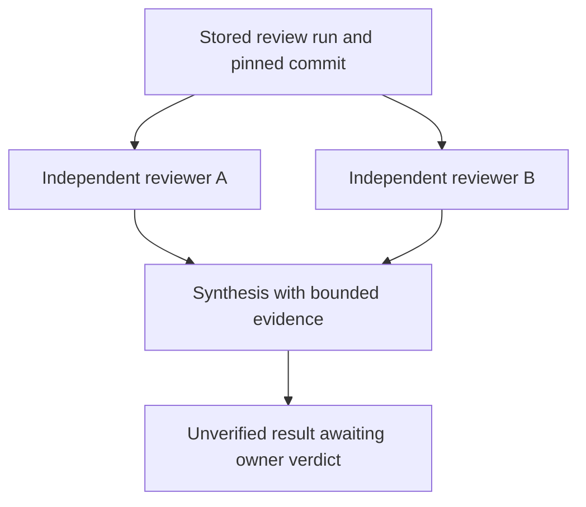

# Reviews, messages and handoffs

Swarmaa keeps memory, authorization, task leases and results in PostgreSQL. The coordination features in this branch add explicit dependencies, invocation-boundary messages and inspectable handoffs to that existing model. The optional Relay connection sends outbound status hints; it does not become the task scheduler or source of truth.

## Start a review of one exact commit

Call `workflow_submit` through the existing MCP connection or `/api/tools/workflow_submit` REST endpoint:

```json
{
  "scope": "project:swarmaa",
  "template": "independent_review_v1",
  "objective": "Review authorization, concurrency and worker isolation. Cite source paths and explain any missing evidence.",
  "base_commit": "6797fdd58c958154fcf0eec31537cd2b1a01ca17",
  "reviewers": ["claude", "codex"],
  "synthesis_provider": "auto",
  "max_attempts": 2,
  "timeout_seconds": 3600,
  "idempotency_key": "review-swarmaa-6797fdd-01"
}
```

Replace the scope and commit with the intended local project and full lowercase commit SHA. The example SHA is the source baseline for this branch, not a moving reference to the implementation. The commit must already exist in each selected worker's configured repository. Review preparation does not fetch remotes, dependencies, submodules or LFS content.

The service atomically creates three tasks:



The two reviewers must be different enabled providers that allow review tasks. When omitted, they are chosen in routing-policy order. Availability determines when each can claim; this is not dynamic reassignment of an explicit reviewer to the provider with most headroom. The synthesis provider can be explicit or `auto`.

All three tasks have the same `base_ref`. Each bridge creates a fresh detached worktree, verifies its HEAD and reports `result.base_commit`. Missing/mismatched provenance blocks the workflow. Independent reviewers receive no sibling findings in `context_get`, and cross-task worker messages to them are rejected. Synthesis is claimable only after both matching-commit reviews complete. It receives their task IDs, versions, bounded answers/summaries and artifact excerpts with hashes and truncation flags. The source snapshot remains available for checking their claims.

`workflow_get({workflow_id})` shows every child, dependencies, owner verification and a recent metadata timeline. An unactivated synthesis is `queued` with workflow phase `waiting_for_dependencies`; it is excluded from claim selection. `workflow_list({scope})` locates runs when switching clients. Both APIs preserve exact tenant/scope authorization.

### Budgets and review

The template creates exactly three tasks. Each has 1–3 attempts (default 2), and the workflow lasts 300–86,400 seconds (default one hour). Lease expiry can retry within that budget. An explicit failed/blocked result stops the workflow; it does not silently start another review. The coordinator reconciles stored state every five seconds and after a server restart, with no overlapping pass in one server process.

The originating principal, credential version, authorization snapshot, scope and OAuth grant remain binding. A later privilege increase does not expand the run. Claim/renewal expiries are capped by the workflow and grant deadlines, and stale workers cannot write through the old generation. `workflow_cancel({workflow_id,expected_version})` fences all pending/running children. Managed children cannot independently use `task_continue` or `task_cancel`; a subsequent review is a new workflow with a new idempotency key.

Successful synthesis sets execution status to `completed` and verification to `unverified`. An owner/admin may call:

```json
{
  "workflow_id": "THE-WORKFLOW-UUID",
  "expected_version": 3,
  "verdict": "approved",
  "reason": "Reviewed the pinned source and the cited evidence; accepted the stated scope."
}
```

Use the current version from `workflow_get`, not the illustrative value above. `rejected` and `unverified` are also valid verdicts. This is a recorded owner decision. Agreement between two models never self-approves a run, and approval does not merge code, publish, deploy or promote memory.

## Send context at an invocation boundary

`task_message_send` accepts `{task_id,body,idempotency_key,kind?,reply_to?}`. Kinds are `context`, `question`, `answer`, `steer`. Frontend/admin senders need both task read and submission authority. Workers additionally supply their current source task ID, lease token and generation; the source and target must have the same exact scope. The service records the principal and source execution, not an inferred human speaker.

| State | Meaning |
|---|---|
| `accepted` | Stored for an eligible invocation boundary. |
| `delivered` | The bridge observed a process start and stdin flush, or supplied an argv prompt. This is not proof the provider consumed it. |
| `deferred` | A later authorized invocation is required; a running CLI has no live injection channel. |
| `failed` | A trusted bridge recorded failure for that frozen delivery batch. |

The bridge calls `task_message_pull` once while holding a live lease, before constructing the prompt. A generation gets one immutable selection, including an empty selection. A batch contains at most 20 messages and 16 KiB including metadata. Each message is at most 4,000 characters / 8 KiB, and a task accepts at most 256 messages. `has_more` is explicit: remaining messages are not silently appended to an already running process.

After the process returns, the bridge records its evidence through `task_message_ack`. Ambiguous acknowledgement retries retain the same batch, status and reason. An unconfirmed receipt can lead to redelivery in a future generation; consumers should keep message IDs when interpreting repeated context. Delivery status never changes the task outcome, grants tools or makes a provider result verified.

Messages sent after a claim wait for a later generation. A message does not create that generation. Ordinary terminal tasks require explicit `task_continue`; terminal managed workflow steps reject new sends because another run requires a new workflow. `task_message_list` exposes attributed content and receipts, with chronological pagination.

## Continue with a sourced handoff

`task_handoff({task_id})` requires task, memory and artifact read permissions. It returns one consistent database snapshot containing:

- The immutable task contract, source principal, task version/generation and workflow identity.
- Pinned and worker-reported Git references, with native session IDs explicitly marked as reported.
- Current memory versions/statuses, changes since the task was created, and unavailable/retracted references.
- Artifact IDs, hashes and run provenance; it does not duplicate entire artifact bodies.
- Linked session metadata and capture coverage, bounded run history and message counts.
- Explicit unverified work and the appropriate continuation policy.

Fetch current memory content with `context_get` and full artifacts with `artifact_get`. A handoff does not transfer hidden model state or grant the receiving provider new authority. `session_record` continues to retain only the latest window of up to 40 user/assistant turns. Session coverage says the full history is unavailable and completeness is unknown; a missing capture is not evidence that no work occurred.

## Runtime and capacity visibility

Workers report static adapter capabilities with `usage_report`. The report states headless transport, next-run delivery only, cancellation support, filesystem confinement requirement, output/time bounds and what observations are available. The CLI version remains unverified. Checkpoints distinguish preparation, process request, observed output and process exit; a quiet process is not proof the agent is thinking, idle or stuck.

The database counts current leases across all scopes for a worker identity. Two bridge processes cannot claim beyond that shared slot count. Quota routing excludes a reporting worker with no free slots, and `swarm_status` reports slots, occupied/free capacity and workflow references on recent tasks. Quota storage still has one last reporter per provider/tenant; this change does not introduce per-account fleet scheduling. A worker's own slot limit remains enforced even when quota data is stale or unavailable.

## Optional Relay notification adapter

The adapter is disabled by default and is unnecessary for workflows, messages or handoffs. It uses Relay's reviewed `createAgentClient`/`dm` API to forward identifiers/status from Swarmaa's existing event stream to one explicit recipient. It sends no objective, transcript, memory body or credential and accepts no inbound execution request.

`config/relay.example.json` is a disabled example. Enabling it requires a separately provisioned compatible `@agent-relay/sdk/messaging` installation, a self-hosted Relay origin, a dedicated pre-provisioned agent token and a Swarmaa identity with `events:read` and `task:read` for the configured exact scopes. Token files use the existing private JSON `{ "token": "..." }` format and owner-only file permissions. No workspace key, hosted fallback, registration or installation happens automatically.

After explicit operator setup and validation, the source entrypoint is:

```sh
npm run relay:notify -- --config /absolute/path/relay.local.json
```

`--once` polls one bounded page per scope. Cursor state is bound to the service identity, Relay identity/origin, scopes and recipient. It advances only after Relay accepts the same stable event idempotency key. Unknown delivery retains the cursor; unresolved SDK requests are bounded. A single-runner lock prevents competing cursor writers. A crash leaves that lock for an operator to inspect before removal. Starting with a new state path can replay historical events; decide the intended notification history before enabling it.

The adapter's `accepted` receipt comes from Relay's send call, not the recipient. Tasks stay authoritative in Swarmaa regardless of Relay availability.

## Upgrade and validation status

Apply additive migrations `019_workflows.sql` and `020_collaboration.sql` through the normal reviewed migration process before starting the upgraded service and bridges. Old workers cannot produce the required pinned-worktree provenance and do not consume message batches; upgrade the participating workers together. Existing `sandbox:false` configurations now fail closed.

This branch contains authored test cases and source review, not executed validation. The macOS filesystem profile, installed CLI flags/authentication, PostgreSQL concurrency and the optional installed Relay SDK need local verification. See the [Claude review handoff](briefs/relay-inspired-coordination-review.md) and [security boundary](SECURITY.md).

Tests and builds were not run. Local Codex should validate the changes before integration.
